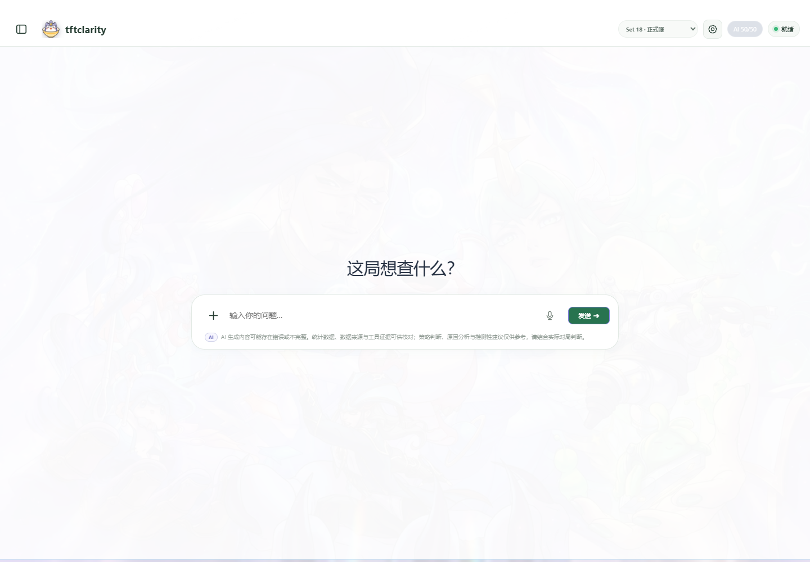
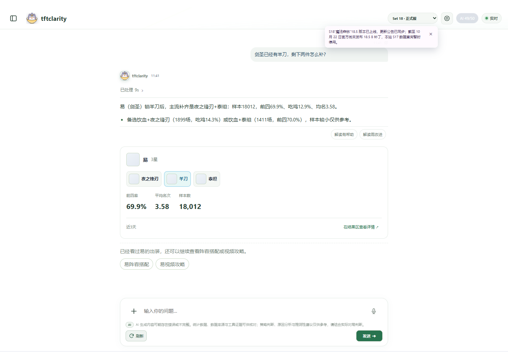
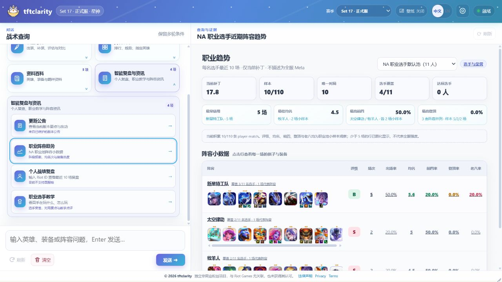
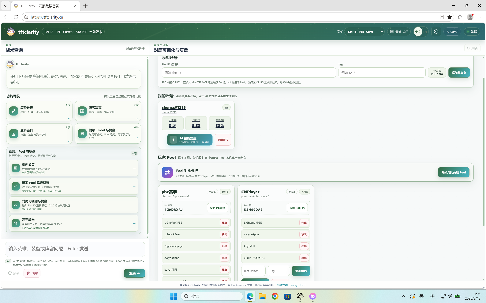
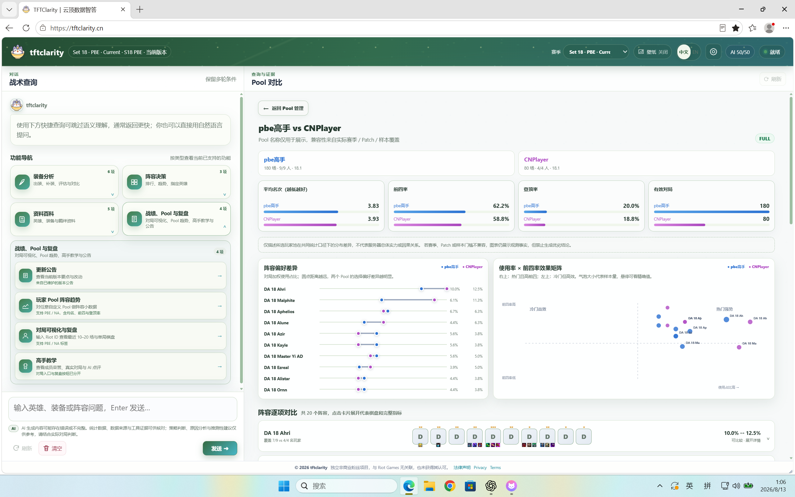
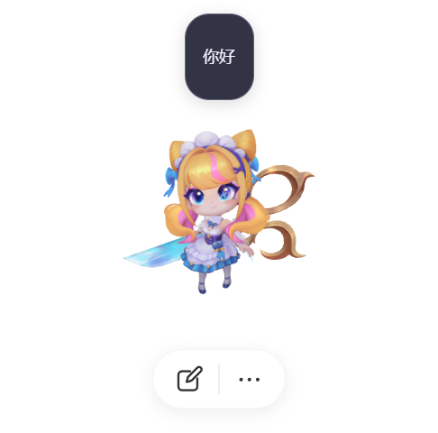
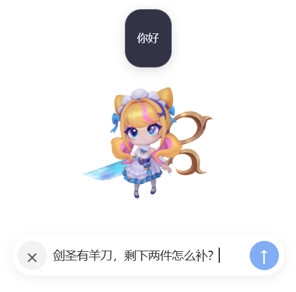

# tftclarity

> 用自然语言查装备、看阵容、读版本变化；结论带着数据与来源。

[在线体验](https://tftclarity.cn/) · [功能总览](#功能总览) · [典型使用方式](#典型使用方式) · [桌宠实验](#windows-桌宠实验) · [快速开始](#快速开始) · [架构与可信度](#架构与可信度) · [V2 部署指南](docs/deploy-v2.md) · [发布就绪状态](docs/r1-release-readiness.md)

开发与版本整合以 `main` 为基线；生产镜像另按部署记录识别。参见[主分支整合与发布约定](docs/main-production-consolidation-20261101.md)。

| 使用入口 | 当前状态 |
| --- | --- |
| [Web 在线体验](https://tftclarity.cn/) | 已上线，浏览器直接使用 |
| [Windows 小窗口](docs/small-window-launcher.md) | 本地启动网站的小窗口 |
| [Windows 桌宠](desktop-pet/README.md) | 实验源码已纳入 `main`，未发布安装包，角色人格默认关闭 |



tftclarity 是面向《云顶之弈》的对话式智能助手。它支持“剑圣有羊刀后两件怎么补”“当前有哪些阵容正在上升”这类自然语言问题转换为受控的结构化查询，也保留了快捷功能入口来提升运行的速度，结合 MetaTFT 统计、版本快照、近期对局、攻略知识和可选的 AI 解读，返回结论、样本规模、风险提示与证据来源。

项目可以作为浏览器 Web 应用、本地 Windows 小窗口或公开服务运行。V2 Public Beta 已部署至 [tftclarity.cn](https://tftclarity.cn/)，当前版本将确定性统计、ReAct Agent、多轮上下文、PBE/NA 玩家数据、攻略知识和证据约束解读整合在同一个界面中。

## 为什么使用 tftclarity？

- **更快读懂结果**：把首选、备选、关键指标和数据限制放在一起，减少来回翻榜单。
- **中文俗称与连续追问**：可以直接说“羊刀、无尽、巨杀、石像鬼”，后续追问会继承英雄、阵容和筛选条件。
- **查询、复盘和教学一体化**：能查看近期终局棋盘、高手样本和B站视频攻略知识。
- **结论可追溯**：同时展示样本、版本、数据来源和风险边界；数据不足时不会强行给出确定结论。

线上功能以现有查询、近期对局、Pool 和证据解读为主。桌宠处于本地试用阶段，实时游戏画面识别尚未接入。

## 功能总览

| 分类 | 当前能力 |
| --- | --- |
| 对话式查询 | 中文自然语言、常见俗称、连续追问、条件继承与修改、无法唯一识别时的候选确认 |
| 装备分析 | 英雄三件套、已有装备补全、单装备定阵、多装备对比、核心装备与竞争关系 |
| 阵容分析 | 阵容排行与趋势、指定英雄、加人/下人/换人的确定性羁绊重算、可展开阵容卡片一图流 |
| 资料百科 | 当前赛季英雄、装备、羁绊详情，中英文名称、常见俗称和版本公告 |
| 对局与复盘 | PBE/NA Riot ID、近期对局、终局棋盘、装备与羁绊、单局详情和 AI 复盘 |
| 玩家 Pool | 最多 2 组、每组 1–15 人、添加/移出/重命名、分享码一键复制、独立管理 |
| 数据看板 | 单 Pool 使用占比、热度 × 前四率气泡矩阵、均名/前四/登顶、代表棋盘 |
| Pool 对比 | 两组 Pool 的总体指标、阵容偏好差异、效果矩阵和逐阵容可展开对比 |
| 攻略知识 | YouTube 字幕知识、Bilibili 攻略搜索、版本窗排序和来源披露 |
| Agent 执行 | ReAct 多工具组合、真实流式事件时间线、证据账本、失败原因和诚实降级 |
| 选段引用 | 选中 AI 回复，把片段加入下一条提问的上下文 |
| 桌宠实验 | 透明置顶、角色拖动、就地输入、回复气泡、查询旁白、摸头喂食；独立本地运行 |

## 典型使用方式

### 自然语言查询

不需要记住完整官方名称或 API 字段，可以直接输入：

```text
剑圣已经有羊刀，剩下两件怎么补？

查询这个阵容里三星贾克斯的出装，样本至少 500。

当前版本有哪些阵容正在上升？

把这个阵容的前排换成奥恩后，羁绊有什么变化？
```

系统会提取英雄、星级、阵容、装备、段位、时间窗口、样本门槛和排序目标。快捷任务走确定性低延迟路径；普通聊天可以由 ReAct Agent 连续调用多个只读工具，并把真实执行事件流式显示在界面中。

### 装备与阵容分析

结果区不会只复述原始榜单，而是把首选、备选、关键指标、样本覆盖和风险提示放在同一条证据链里。阵容查询会返回可展开的阵容卡片；加人、下人或换人后的羁绊人数与档位由代码重新计算，AI 只解释已计算出的变化。



首页与上图查询结果截取于 2026-11-01；数值是当时查询结果，仅用于展示界面。后续 Pool 图片为功能示例。

### 高手趋势与教学复盘

职业与自定义玩家样本支持阵容频率、玩家覆盖、平均名次、前四率、登顶率、老八率、代表棋盘和装备热度。AI 教学与复盘只基于已经取得的结构化证据，目前仅使用PBE和NA服务器的账号进行功能验证。



### 对局可视化与复盘

“战绩、Pool 与复盘 → 对局可视化与复盘”支持两条明确隔离的路径：

- PBE：个人查询使用 `PBE数字` 标签，例如 `XXX#PBE`；通过 MetaTFT Player Match MCP 返回最多 20 场近期终局数据。
- NA：使用 `NA数字` 标签，例如 `Player#NA1`；沿用 OP.GG 正式服采集与本地增量事实库。

两条路径不会互相回退。页面可展开近期对局、终局棋子、装备、羁绊和单局详情，也可以基于已取得的结构化证据生成复盘建议。外部来源没有提供的逐回合经济、搜牌路径或站位过程不会被伪造。

当前版本尚未接入 Riot Sign On。访客输入 Riot ID 不代表已经证明账号所有权；现阶段的 PBE/NA 玩家与对局数据分别来自已披露的第三方来源。项目正在以完整现有功能申请 Riot Production 与 RSO 评审，并会按照 Riot 的审核结论限制、调整或移除需要账号授权的流程。

## 玩家 Pool

Pool 是“战绩、Pool 与复盘”中的进阶能力，用于把用户自己选择的玩家组织成可维护并且可相互对比的小数据集；当前设置每位访客最多管理 2 个 Pool，每组 1–15 个角色，以方便进行功能验证。

### 创建与管理

1. 打开“战绩、Pool 与复盘 → 对局可视化与复盘”。
2. 输入 Pool 名称、环境和首个 Riot ID，验证成功后创建。
3. 在 Pool 卡片中继续添加或移出角色；每组最少 1 人、最多 15 人。
4. 点击“打开数据看板”查看单 Pool 的阵容分布和表现。

Pool 名称只用于展示，不决定服务器、赛季或统计口径。环境、赛季、Provider、Patch 和有效样本会单独记录并展示。



### 分享码

- 每个 Pool 可以生成一个 8 位分享码。
- 其他访客输入分享码后，会得到成员名单的独立副本。
- 比赛事实可以复用，成员关系不会共享；任一方增删角色都不影响另一方。
- 导入仍受“每人最多 2 个 Pool、每组最多 15 人”的限制。

### 单 Pool 数据看板

数据看板不再只是原始表格，当前包含：

- 玩家覆盖、有效对局、平均名次、前四率与登顶率；
- Top 10 阵容的对局加权占比与玩家等权占比；
- “阵容热度 × 前四率”气泡矩阵，气泡大小表示样本量；
- 可展开阵容卡片，展示均名、前四、登顶、玩家覆盖和代表终局棋盘；
- 可选的完整指标表，便于核对精确值。

### 两个 Pool 如何对比

1. 创建第二个 Pool，或通过 Pool 码导入第二组成员。
2. Pool 管理页顶部的“Pool 对比分析”会从 `1/2` 变成可操作状态。
3. 点击“开始对比两组 Pool”。
4. 查看总体表现、阵容偏好哑铃图、使用率 × 前四率效果矩阵和逐阵容详情。



系统会先检查赛季、Patch 和样本覆盖。口径兼容且样本达到门槛时标记为 `FULL`；否则只并列展示观测事实，不生成“哪组更强”的结论。

## Windows 桌宠实验

桌宠把聊天入口放在桌面上，适合一边游戏、一边查资料的场景。当前版本在本机试用，源码位于 [desktop-pet/](desktop-pet/README.md)，不随网站部署启动。

<table>
  <tr>
    <td align="center"><br>轻量入口：悬停显示，离开后收起</td>
    <td align="center"><br>就地输入：不用先打开完整聊天窗口</td>
  </tr>
</table>

- **就地聊天**：点击输入图标展开输入条，Enter 发送；回复显示在头顶气泡，点击可查看完整聊天。
- **少遮挡**：底部操作条自动隐藏；气泡按字数显示 4～15 秒后收起，查询进行时保留进度。
- **角色互动**：单击摸头、按住拖动；右键菜单中喂食、查看亲密度或切换安静模式。
- **跟随移动**：完整聊天窗口跟着角色移动，手动调整的窗口尺寸会保留。
- **角色配置**：模型动作、旁白与后端人格分开管理，后续可扩展其他角色。人格只影响表达，沿用现有工具、上下文和证据规则。

上图是本地原型的实际界面，输入条展示的是未发送的示例草稿，不代表安装包已公开提供。角色素材属于各自权利人；截图展示不构成模型授权，仓库不包含格温模型、其他角色图片或个人会话缓存。运行需自行准备有权使用的素材，详见[素材与许可说明](desktop-pet/THIRD_PARTY_NOTICES.md)。

**适用范围**：Windows 本地原型，窗口化/无边框游戏需实际测试。独占全屏兼容性未确认；国服已收到“桌宠可见但不能点击”的反馈，尚未完成国服兼容修复。当前不提供游戏画面识别、语音对话或自动游戏操作。

开发和本地试用入口见[桌宠说明](desktop-pet/README.md)，人格接入及默认关闭策略见[架构说明](docs/desktop-companion-persona-architecture.md)。

## 数据口径与可信度

tftclarity 的核心原则是“统计由代码计算，模型只在证据范围内解释”。

- 对局加权：每场对局权重相同，适合观察 Pool 中实际出现了多少次。
- 玩家等权：先计算每位玩家内部的阵容占比，再在玩家之间平均，避免高频玩家支配整体结果。
- 平均名次：越低越好。
- 前四率：最终名次为 1–4 的对局比例。
- 登顶率：最终名次为 1 的对局比例。
- 样本门槛：样本不足、Patch 不齐或赛季不一致时，界面会降低结论强度并显示原因。

目前使用MetaTFT、OP.GG 和攻略平台等作为外部数据源，接口变化、网络失败和缓存过期可能影响结果。Pool 是用户自行选择的有限样本，不代表整个服务器，也不能用于推导因果关系。

## 架构与可信度

```text
用户输入 / 快捷任务
        ↓
┌──────────────────────────┬──────────────────────────┐
│ QuickTask 确定性快速路径 │ ReAct Agent 多工具路径   │
│ 解析 → 查询 → 结果策略    │ Decide → Tool → Observe │
└──────────────────────────┴──────────────────────────┘
        ↓ Conversation Bridge / Agent Event Stream
Tool Registry → Tool Executor → Evidence Ledger
        ↓
MetaTFT / Player Match MCP / OP.GG / 版本与攻略知识
        ↓
确定性聚合、样本门槛、赛季与 Patch 校验
        ↓
EvidenceBundle → 证据约束解读 → Web UI
```

主要设计约束：

- 确定性优先：实体解析、过滤、聚合、排序、指标和羁绊重算由代码完成。
- 工具白名单：Agent 只能调用注册目录中的只读工具，并受参数 Schema、超时、重复调用和无进展保护约束。
- 证据约束：模型不能提供 EvidenceBundle 中不存在的数字、实体或来源。
- 真实状态：前端保留 Agent 的实际执行事件，不用固定占位文案冒充处理进度。
- 诚实降级：样本不足、来源失败或模型输出不合格时，返回可验证的确定性结果并说明边界。
- 赛季隔离：会话、缓存、目录、Pool 统计和查询均携带赛季上下文。

范围说明：G4-B 装备分配优先级不在本次 Beta 承诺范围；当前的终局数据解读不等于完整对局时间线复盘。

## 快速开始

### 环境要求

- Windows、macOS 或 Linux
- 推荐 Node.js 24（与当前测试和生产 Docker 镜像一致）；最低 Node.js 20
- Node.js 20–21 使用 SQLite 时需要成功安装可选依赖 `better-sqlite3`

### 本地启动

```powershell
git clone https://github.com/Chencc7002/tftclarity.git
cd tftclarity
npm ci
npm start
```

打开 [http://127.0.0.1:17317/](http://127.0.0.1:17317/)，健康检查：

```powershell
Invoke-RestMethod http://127.0.0.1:17317/api/health
```

Windows 网站小窗口（与独立桌宠不同）：

```powershell
npm run window
```

只启动服务，不自动打开浏览器：

```powershell
npm run window:server
```

启动器的窗口尺寸、位置、置顶、浏览器路径与全局热键参数见 [Windows 小窗口启动器说明](docs/small-window-launcher.md)。

## 配置

基础静态查询可以在没有 LLM 的情况下运行。需要 ReAct Agent、语义检索、证据约束解读、攻略知识或真实玩家数据时：

```powershell
Copy-Item .env.example .env
```

常用配置：

| 配置 | 作用 |
| --- | --- |
| `TFT_AGENT_COMPANION_PERSONA_MODE` | 桌宠人格：`off / shadow / on`，默认 `off`；需显式启用和会话存储 |
| `TFT_AGENT_REACT_CHAT_MODE` | 开启普通聊天的 ReAct Agent 路径 |
| `TFT_AGENT_REACT_TASK_FRAME_CONTROL_V1` | 让宽泛英雄玩法问题使用受控 TaskFrame 语义建议 |
| `TFT_AGENT_REACT_TASK_FRAME_SHADOW_V1` | 记录 TaskFrame 影子解析观测，不改变最终回答 |
| `AGENT_SKILLS_SHADOW_V1` | 记录生产 Skill 1.3.0 的匹配与证据覆盖，不改变最终回答 |
| `AGENT_SKILLS_CANDIDATE_SHADOW_V1` | 记录候选 Skill 1.5.11 的匹配、工具交集和内容哈希；默认关闭，不执行候选指令 |
| `AGENT_SKILLS_UNIT_PLAY_CONTROL_V1` | 单用户候选控制；只有精确值 `unit_play_guidance@1.5.11` 才启用，其他值（包括 `on`）均保持关闭 |
| `TFT_AGENT_CONVERSATION_BRIDGE_MODE` | 将快捷任务的目的、条件和结果传入后续聊天 |
| `TFT_AGENT_CONCLUSION_MODE` | 开启证据约束的数据解读 |
| `TFT_AGENT_KNOWLEDGE_MODE` | 本地知识检索总开关 |
| `TFT_AGENT_EMBEDDING_MODE` | 持久化语义向量检索；生产 Compose 使用本地 `bge-m3` |
| `METATFT_PLAYER_MATCH_ENABLED` | 启用 MetaTFT Player Match MCP |
| `METATFT_PBE_ENABLED` / `METATFT_NA_ENABLED` | 分别控制 PBE 与 NA 数据路径 |
| `OPGG_PUUID_ENCRYPTION_KEY` | 可选的 PUUID 静态加密密钥；未配置时不落盘 PUUID |
| `BILIBILI_MCP_ENDPOINT` | 只读攻略视频 MCP 的内部地址 |

完整配置和安全占位符见 [.env.example](.env.example)；公开部署模板见 [.env.production.example](.env.production.example)。不要提交真实 API Key、PUUID、Cookie 或数据库密码。

## 常用命令

| 命令 | 用途 |
| --- | --- |
| `npm start` | 启动本地 Web 服务 |
| `npm run window` | 启动 Windows 桌面小窗口 |
| `npm run test:ci:main` | 运行标准主测试通道 |
| `npm run test:ci:integration` | 运行标准集成测试通道 |
| `npm run smoke:small-window` | 验证本地 API 主流程 |
| `npm run smoke:visual` | 运行多断点视觉冒烟测试 |
| `npm run smoke:metatft` | 验证 MetaTFT 数据链路 |
| `npm run smoke:metatft:player-mcp` | 验证玩家近期对局 MCP |
| `npm run smoke:react-chat:live` | 验证真实模型 ReAct 多工具聊天 |
| `npm run semantic:index` | 构建持久化语义索引 |
| `npm run semantic:audit` | 审核语义索引状态 |
| `npm run stats:daily` | 执行一次 current_stats 日任务 |
| `npm run opgg:collect:watch` | 持续增量采集 OP.GG 玩家数据 |
| `npm run eval:agent` | 运行核心 Agent 离线评估 |

真实 MetaTFT、OP.GG、Bilibili、YouTube 或模型测试会受到外部服务、网络和额度影响。

## 生产部署

生产 Compose 使用以下组件：

整体存储与执行方式为 PostgreSQL 持久业务存储、Redis 临时状态/队列、独立 Worker，并把 embedding 与外部 MCP 放在不直接暴露宿主端口的内部网络中。

- `app`：Web/API 服务；
- `worker`：异步任务；
- `postgres`：持久业务数据；
- `redis`：临时状态与队列；
- `embedding`：内部 Ollama `bge-m3`，不暴露宿主端口；
- `metatft-player-mcp`：近期玩家对局工具；
- `bilibili-mcp`：只读攻略视频工具；
- `caddy`：HTTPS、反向代理和安全头。

```bash
cp .env.production.example .env.production
docker compose --env-file .env.production up -d --build
docker compose --env-file .env.production ps
curl -fsS https://your-domain.example/api/health
curl -fsS https://your-domain.example/api/ready
```

数据库迁移、备份、健康检查、容量门槛、恢复和回滚步骤见 [V2 production 部署指南](docs/deploy-v2.md)。

## 测试与质量门槛

```powershell
npm run test:ci:main
npm run test:ci:integration
npm run smoke:small-window
npm run smoke:comps
npm run eval:agent
```

测试覆盖自然语言解析、实体链接、多轮上下文、能力规划、工具安全、结果策略、阵容与装备统计、赛季隔离、缓存、SQLite/PostgreSQL、玩家 Pool、分享码、Pool 对比、近期对局 MCP、攻略知识、流式事件和前端交互。

## 进一步阅读

- [桌宠源码、运行方式与交互](desktop-pet/README.md)
- [桌宠人格架构与会话隔离](docs/desktop-companion-persona-architecture.md)
- [玩家 Pool 产品与统计口径](docs/player-pools.md)
- [MetaTFT Player Match MCP](docs/metatft-player-match-mcp.md)
- [R1 独立 ReAct 与 Conversation Bridge](docs/react-chat-r1-architecture.md)
- [LLM 检索与证据流水线](docs/llm-retrieval-evidence-pipeline.md)
- [语义索引构建](docs/semantic-index-build.md)
- [攻略知识与混合回答](docs/youtube-hybrid-operations.md)
- [管理员赛季与数据运维](docs/admin-season-operations.md)
- [V2 production 部署、恢复与回滚](docs/deploy-v2.md)
- [V1 腾讯云部署指南（历史单机参考）](docs/deploy-tencent-cloud-v1.md)
- [Riot 法务与生产部署说明](docs/riot-legal-production-deploy.md)

## 数据来源与项目声明

- MetaTFT 用于当前统计和 PBE 玩家终局数据；它是非官方外部来源。
- OP.GG 用于正式服玩家与职业池的增量观察；有限样本不代表全服 Meta。
- Riot 官方公告只用于版本事实。
- YouTube、Bilibili 和其他攻略内容只用于原因、背景与条件性建议，并保留来源披露。
- `.probe/` 中的离线捕获样本只用于回归测试、目录审核和数据契约验证。

tftclarity 是由玩家独立制作的非商业粉丝项目，与 Riot Games 不存在隶属、合作、赞助或认可关系。Riot Games、Teamfight Tactics 及相关角色、图像、名称和游戏资产归 Riot Games 或其权利人所有。
